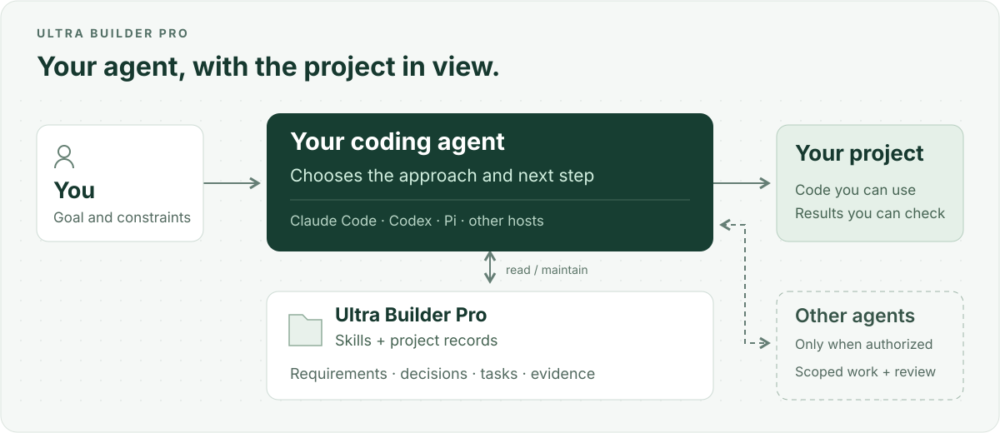

# Ultra Builder Pro

**English** · [简体中文](README.zh-CN.md)

Give your coding agent a way to keep the goal, the project context, and the evidence together.

Ultra Builder Pro is a plugin for coding agents. It helps them clarify a request,
work through a change, check the result, and leave enough context for the next
session to continue. You work in your usual agent; Ultra supplies Skills, project
files, and tools for optional delegation.



[Get started](#get-started) · [Examples](#using-ultra) · [Documentation](docs/README.md) · [Changelog](CHANGELOG.md)

## Why use it?

If you ask for "free shipping for members" and get "half-price shipping," passing
tests won't fix the misunderstanding. A coding agent can implement its own
interpretation perfectly while missing what you asked for.

Longer projects add another problem: decisions disappear between sessions. You
explain an interface again, reconstruct unfinished work, or discover that the
implementation and the spec now describe different products.

Ultra gives that work a place to live in the repository:

| When this happens | What Ultra asks the agent to do |
|---|---|
| The request leaves an important question open | Clarify the intended use before committing to a design |
| The implementation starts drifting | Compare the change with the accepted requirements and record decisions |
| Tests pass but the feature is unusable | Check the real caller, data path, persistence, and user-visible result |
| A session ends halfway through | Record the current task, evidence, and next action in project files |
| Work could benefit from another agent | Delegate a scoped task when authorized, then inspect and integrate its result |

This is useful for projects you expect to revisit and change. A small, clear fix
can stay small: the agent investigates, edits, and verifies it without creating a
project plan or a directory of workflow records.

## Get started

You need Node.js 22 or newer and a coding agent you can already use. Install into
the host you work with; these are alternatives:

```bash
# Claude Code
npx ultra-builder-pro-cli@latest --claude --global

# Codex
npx ultra-builder-pro-cli@latest --codex --global
```

Start a new session in your project and describe the work:

```text
Use Ultra Builder Pro to add CSV export to this project.
Keep the existing fields and verify that Chinese text opens correctly.
```

Natural-language discovery depends on the host. If it does not select Ultra, use
the host's Skill picker; Codex exposes names such as
`$ultra-builder-pro:ultra-change`. You can describe the task without learning the
internal workflow names.

The npm commands install the published package. For the source checkout's goal
entry, Pi setup, project-local installation, or troubleshooting, see the
[usage guide](docs/USAGE.md). Release changes live in the [changelog](CHANGELOG.md).

## Using Ultra

You choose the outcome and constraints. The model chooses how to work within them.

For an existing project:

```text
Use Ultra to add recurring invoices. Read the current billing code first.
Keep one-off invoices working, and ask before changing the public API.
```

For a new product:

```text
Use Ultra to build a receipt organizer for reimbursements.
I need to find original receipts by month and export a CSV for my accountant.
```

For a return to unfinished work:

```text
Use Ultra to continue the invoice task. Read the project records and current
diff first, tell me what remains, and continue the local implementation.
```

For an independent check:

```text
Let Pi review this change for missing edge cases.
Keep implementation and integration in this session.
```

The last example explicitly permits delegation. "Use Ultra" on its own selects
the working method; it does not authorize other agents. You can also allow
delegation within a scope and budget, then let the model choose the individual
tasks. Each target still needs an available, qualified runtime.

## How it works

Your current agent remains in charge. In Codex, that is Codex; in a Pi session, it
is Pi. Ultra does not require every task to pass through Pi or follow the same
sequence of stages.

The package contains fourteen Skills. They cover clarification, research,
planning, development, testing, review, delivery, and recovery. The model reads
the methods relevant to the task. Five optional hooks bring project context back
into view and check a limited set of destructive commands.

Most work can stay with one agent. When delegation is useful and authorized,
workers receive a bounded task and their own Git worktree. The main agent reads
the results, checks the actual changes, and handles integration. Review uses the
relevant lenses within a budget; it does not automatically turn every minor
finding into another repair cycle.

For larger changes, the project keeps readable records:

| Location | What the next session can find there |
|---|---|
| `.ultra/north-star.md` and `.ultra/specs/` | The accepted goal and product behavior |
| `CONTEXT.md` | Shared terms and domain relationships |
| `.ultra/tasks.json` and `.ultra/contexts/` | Tasks, acceptance criteria, and resume notes |
| `.ultra/decisions/` and `.ultra/evidence/` | Decisions, test observations, and review evidence |
| Git | The code, its changes, and their history |

The agent reads and maintains these files as it works. They travel with the
repository, so another session or host can recover the project context. They do
not grant permission to resume by themselves. See [workflow and recovery](docs/USAGE.md#workflow-and-recovery)
for session authorization and unattended continuation.

## Where it runs

| Host | How Ultra loads |
|---|---|
| Claude Code | Native plugin; project or user installation |
| Codex | Native plugin and Skill metadata; project or user installation |
| OpenCode | Native plugin and Skills; project or user installation |
| Kimi Code | User plugin |
| Grok Build | User plugin |
| ZCode | User plugin; delegation is currently unavailable |
| Pi | Session-loaded Skills and extension through the source goal entry |

Installation support and delegated execution are separate capabilities. The
[compatibility matrix](docs/RUNTIME-COMPAT-MATRIX.md) records the exact transport,
permission, and host limitations.

Pi's finite parallel batches and unattended checkpoints are experimental. Each
durable checkpoint allows at most one fresh Pi turn under an explicit grant;
unknown delivery is not retried automatically. General recovery from machine
restarts and network partitions is not yet established. Parallel work also has
coordination costs; Ultra does not promise that more agents will be faster or
cheaper.

## Documentation and contributing

Start with the [usage guide](docs/USAGE.md) or browse the [documentation index](docs/README.md).
For the design, read [architecture](docs/ARCHITECTURE.md) and
[philosophy](docs/PHILOSOPHY.md). Implementation contracts live alongside their Skills.

To work on Ultra itself, install Node.js 22+, Python 3, Git, and pytest. From a
checkout:

```bash
npm ci
npm run verify:release
npm pack --dry-run --json
```

Keep changes focused, include the relevant checks, and describe what someone
can now do. Bug reports are more useful with the host, the command or request,
expected behavior, and a small reproduction. Remove credentials and private
project data before [opening an issue](https://github.com/rocky2431/ultra-builder-pro-cli/issues).

[MIT license](LICENSE)
