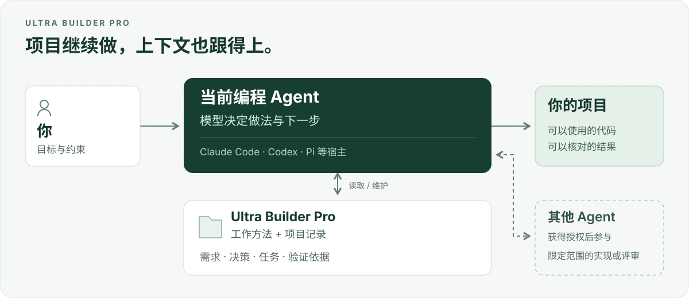

# Ultra Builder Pro

[English](README.md) · **简体中文**

让编程 Agent 带着同一份目标、项目上下文和验证依据，把工作继续做下去。

Ultra Builder Pro 是一个编程 Agent 插件。它帮助 Agent 理解需求、完成改动、
检查实际结果，并为下一次会话留下足够的上下文。你继续使用熟悉的 Agent，
Ultra 提供工作方法、项目文件，以及可选的委派工具。



[开始使用](#开始使用) · [使用示例](#怎样使用) · [文档](docs/README.md) · [更新记录](CHANGELOG.md)

## 它解决什么问题

你要的是“会员免运费”，Agent 写成了“运费打五折”。即使测试全部通过，
需求仍然做错了。Agent 可能很好地实现了自己的理解，却偏离了你的原意。

项目做久了，还会遇到另一种麻烦：换个会话，上次的决定就丢了。你需要重新解释
接口、找回未完成的工作，或者发现规格和代码已经在描述两个不同的产品。

Ultra 把这些工作需要的信息留在仓库中：

| 遇到的问题 | Ultra 引导 Agent 做什么 |
|---|---|
| 需求还有重要问题没说清 | 先确认用途，再决定设计 |
| 实现逐渐偏离原意 | 对照已接受的需求检查改动，记录重要决定 |
| 测试通过，但功能用不了 | 检查真实调用、数据流、持久化和用户能看到的结果 |
| 会话中途结束 | 留下当前任务、验证依据和下一步说明 |
| 某部分适合另一个 Agent 参与 | 获得授权后委派明确范围的工作，再检查和集成结果 |

它适合需要持续迭代、隔一段时间还会回来修改的项目。清楚的小修可以直接调查、
修改和验证，不必先生成一份项目计划，也不必额外建立一整套工作流文件。

## 开始使用

需要 Node.js 22 或更新版本，以及一个你已经能正常使用的编程 Agent。
选择你使用的宿主安装即可：

```bash
# Claude Code
npx ultra-builder-pro-cli@latest --claude --global

# Codex
npx ultra-builder-pro-cli@latest --codex --global
```

在项目中开启新会话，直接说明要做的事情：

```text
用 Ultra Builder Pro 给这个项目增加 CSV 导出。
保留现有字段，并验证中文内容能够正常打开。
```

自然语言发现取决于宿主。如果它没有选中 Ultra，可以用宿主的 Skill 选择器；
例如 Codex 会显示 `$ultra-builder-pro:ultra-change` 这样的条目。
日常使用时说明任务即可，不需要先学会内部工作流的名字。

npm 命令安装的是已发布软件包。源码中的目标入口、Pi 接入、项目级安装和排错
见[使用指南](docs/USAGE.md)；版本变化统一记在[更新记录](CHANGELOG.md)中。

## 怎样使用

你决定结果和约束，模型在这个范围内选择具体做法。

给已有项目增加功能：

```text
用 Ultra 增加周期性账单。先阅读现有计费代码。
保留一次性账单的行为；如果需要修改公开 API，先跟我讨论。
```

开始一个新产品：

```text
用 Ultra 做一个报销收据整理工具。
我需要按月份找到收据原件，并导出 CSV 给会计。
```

继续未完成的工作：

```text
用 Ultra 继续账单任务。先读项目记录和当前 diff，
告诉我还剩什么，然后继续本地实现。
```

请另一个 Agent 检查：

```text
让 Pi 评审这次改动，重点找遗漏的边界情况。
实现和集成仍然由当前会话负责。
```

最后一个例子明确授权了委派。单说“用 Ultra”只选择工作方法，不会自动授权
其他 Agent 参与。你也可以先允许一定范围和预算内的委派，再让模型决定具体
分工。目标 Agent 的运行环境仍需可用，并满足对应的权限要求。

## 它怎样工作

当前 Agent 始终负责判断。在 Codex 中使用 Ultra，主 Agent 就是 Codex；
在 Pi 会话中使用，主 Agent 就是 Pi。任务不必经过 Pi，也不必走相同的阶段顺序。

软件包包含十四个 Skills，覆盖澄清、研究、计划、开发、测试、评审、交付和恢复。
模型按任务需要读取相应的方法。五个可选 Hooks 用于提醒项目上下文，并检查
一小组破坏性命令。

多数工作可以由一个 Agent 完成。适合分工且获得授权时，Worker 会拿到明确的
任务范围，在独立 Git worktree 中工作；主 Agent 检查结果和实际改动，负责
集成。评审按变更选择检查角度，并在预算内结束，不会因为每个小问题都继续
扩展修复轮次。

对于较大的变更，项目会保留这些可读记录：

| 位置 | 下一次会话可以从中找到什么 |
|---|---|
| `.ultra/north-star.md` 和 `.ultra/specs/` | 已接受的目标和产品行为 |
| `CONTEXT.md` | 共同使用的术语和领域关系 |
| `.ultra/tasks.json` 和 `.ultra/contexts/` | 任务、验收条件和恢复说明 |
| `.ultra/decisions/` 和 `.ultra/evidence/` | 决策、测试观察和评审依据 |
| Git | 代码、改动及其历史 |

Agent 在工作时读取和维护这些文件。它们随仓库保存，因此换个会话或宿主也能
恢复项目上下文。文件本身不会授权继续执行；会话授权和无人值守续接的区别，
见[工作流与恢复](docs/USAGE.md#workflow-and-recovery)。

## 支持哪些宿主

| 宿主 | 加载方式 |
|---|---|
| Claude Code | 原生插件，支持项目级和用户级安装 |
| Codex | 原生插件与 Skill 元数据，支持项目级和用户级安装 |
| OpenCode | 原生插件与 Skills，支持项目级和用户级安装 |
| Kimi Code | 用户级插件 |
| Grok Build | 用户级插件 |
| ZCode | 用户级插件；当前委派路径不可用 |
| Pi | 通过源码目标入口，为当前会话加载 Skills 和扩展 |

能够安装插件与能够作为委派目标执行，是两种不同的能力。
[兼容性说明](docs/RUNTIME-COMPAT-MATRIX.md)记录了具体的传输、权限和宿主限制。

Pi 的有限并行批次和无人值守检查点仍属实验能力。每个持久检查点需要明确授权，
最多开启一次新 Pi 轮次；发送结果不明时不会自动重试。完整的机器重启和网络
分区恢复能力仍待验证。并行也有协调成本，Ultra 不承诺 Agent 越多就越快、越省钱。

## 文档与贡献

从[使用指南](docs/USAGE.md)开始，或浏览[文档索引](docs/README.md)。
设计说明见[架构](docs/ARCHITECTURE.md)和[设计原则](docs/PHILOSOPHY.md)；
具体实现合同与对应的 Skill 放在一起。

参与 Ultra 开发需要 Node.js 22+、Python 3、Git 和 pytest。在源码目录运行：

```bash
npm ci
npm run verify:release
npm pack --dry-run --json
```

请让改动保持聚焦，附上相关检查，并说明用户因此能做什么。报告问题时，提供
宿主、使用的命令或请求、预期行为及最小复现会更有帮助。
[提交 Issue](https://github.com/rocky2431/ultra-builder-pro-cli/issues) 前，请移除凭据和私人项目数据。

[MIT 许可证](LICENSE)
