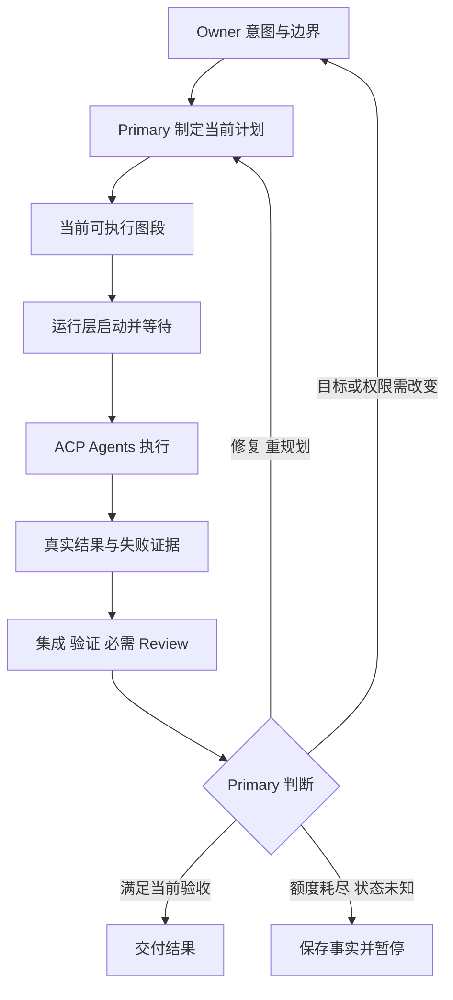

# 当前体验整改与自动化软件工厂：Codex 待对抗方案

2026-09-05。**这是 Codex 的方案草案，尚未获得实现授权。** Claude 第一轮因会话额度限制中断，Owner 随后明确改为 Codex、ZCode、Kimi 三方三轮交叉审查，详见 [记录](./01-claude-round1-incomplete.zh-CN.md)。初始立场保持原样；本文作为新第一轮的待审方案。

## 两个命题

**命题一：当前优先问题是 Owner 无法看到意图如何收敛、何时能交付，而既有验证与流程合同尚未在真实使用中证明能解决这个问题。** 要整改的是实际对话和交付路径，不是先新增一组状态字段。

**命题二：产品是自动化软件工厂；目标与边界由 Owner 定义，Agent 在边界内自主构建和修改执行图，工厂通过 ACP 驱动真实工作，再以执行证据推动当前任务改进和未来工作流演化。** 完成不是任务图全绿，而是约定结果在真实环境中成立。

两者相互依赖：意图不清就会自动化地做错；只改善提问而没有运行、反馈与恢复，也不会成为工厂。[证据 C1/C2/C4/C8](./evidence-codex.zh-CN.md)

## 1. 当前先改什么

| 候选修改 | 当前依据 | 可观察验收 |
|---|---|---|
| 把每次 Research 限定在会影响近期行动的决定上，先自查事实，给出推荐及反证条件 | `ultra-grilling` 已写“事实自己查”，但同时强制 reframe 和逐答确认；Owner 报告重复专业提问 | 已给出的答案被直接复用；技术事实由 Agent 查；Owner 能指出本轮还需决定什么和何时退出 |
| 仅在歧义、冲突或实质风险出现时重述／重新界定目标 | `skills/ultra-grilling/SKILL.md:25-39` 无条件确认要求 | 清晰小改动直接推进；含关键冲突的请求仍能问出必要问题；不靠硬性问题数伪装收敛 |
| 默认给简短进度：目标、已验证结果、未解决缺口、下一步、需 Owner 的决定 | 已有 Route Card、Alignment Card、RunStatus，当前缺真实旅程证明 | Owner 不读 receipt/schema 也能判断位置；展示内容可追溯至当前证据，不能用任务数假装语义完成率 |
| 减少重复 Hook 注入，核对工作流激活、任务切换和恢复边界 | `hooks/mid_workflow_recall.py:16-41` 每次匹配重新注入 acceptance；`.ultra/` 存在本身不等于本轮授权 | 普通聊天不被旧任务牵走；同一信息不持续重复；新会话和当前验收变更仍能恢复正确上下文 |
| 统一新项目、持续迭代、旧项目接管的当前意图与影响检查 | 已有 `ultra-change` 短路径与 reconciliation；Owner 的 V1 主要缺陷是多轮迭代后漂移 | 小改动不重走完整访谈；跨模块改动识别影响；连续修改后仍通过整体关键用户路径 |

上述是有源码支持的候选因果，仍需真实会话复现，不把用户体验问题“证明”为纯 Prompt bug。Task Evidence v2 的四种证据、当前 Goal 的验收覆盖和独立 Review 应复用。命令检查、人工判断和外部事实各有适用范围，不能全部压成单一 exit code。[C2/C8](./evidence-codex.zh-CN.md)

**先跑三个固定旅程**：从模糊想法到首个可用结果；已有项目的一次小改加后续跨模块迭代；旧项目接管后修复一个真实问题。用同样输入比较当前版本和候选版本，记录 Owner 实际投入时间、重复／无用问题、关键问题漏问、首次可用结果、整体回归、错误完成与误拒绝。初轮小样本只能定位机制，不能推算普适成功率。一次只改变能解释差异的因素，避免“全删”后无法归因。[C2/C8；METR 更新](https://metr.org/blog/2026-02-24-uplift-update/)

## 2. ACP 迁移：明确删除与保留边界

Owner 已确认复用现有 `agent-delegation／ACPX`。Goal 的 delegation 样例已经使用 `agent-delegate`；UBP 则还拥有自己的完整委派链。两者不能笼统地叫“尚未接 ACP”。

| 职责 | 迁移方向 |
|---|---|
| Agent 注册、实际可用性、通道连接、prompt/session、事件、普通 receipt | 以现有 ACP Skill 为复用入口；核对其一次性 wrapper 与 ACPX 持久会话能力的差异 |
| 目标、任务意图、角色选择、工作拆分、何时修复或重规划 | Primary Agent 的语义职责；移除重复 Prompt/路由要求，不交给 transport 决定 |
| 每个任务的工作区与写入边界、环境隔离、预算、取消、未知结果核对 | 工厂必须明确承担；优先复用已存在且通过验证的逻辑，不能因换 CLI 而丢失 |
| 真实结果、当前输入、验收与独立 Review、合并后整体验证 | 复用 UBP / Goal 中适用的证据合同；ACP stop reason 或 wrapper success 不裁决产品完成 |

当前 wrapper 继承进程环境且输出通用 assistant text；它并非 UBP 的全部安全合同的替代品。本次额度中断也说明：接通 Agent 和一次任务成功是不同事实，工厂需要保存未完成原因与可恢复入口。[C4/L2、实际 CC 收据](./evidence-codex.zh-CN.md)

实施时先列出现有消费者，再做最小兼容接入和等价检查，最后删除重复连接／profile 逻辑。新接口至少验证启动、进度、正常结束、额度耗尽、取消失败、写入状态未知、重复结果与跨会话恢复。没有通过所选 Host 的实际验证，能力就不能标成可用。

## 3. 图怎样真正自动运行

不预编译整个未来；每次编译当前有足够依据执行的一小段图。图可以包含依赖、并行、汇合及反馈回边；节点内仍由 Agent 自主使用工具。复杂任务的未来节点可以在新证据出现后增加、删除、拆分、合并或重排，必须记录原因并重查受影响的下游条件。[C3/C5](./evidence-codex.zh-CN.md)

正常闭环中，每次修复、换已授权策略、启动下一段都不需要 Owner 重新批准。Owner 只处理未授予的效果、实质意图改变、不可推导的决定。等待由进程或合格的原生机制承担，不能靠模型反复询问 status 保活。恢复时核对当前事实和原有授权，不能因为有状态文件就重新启动一个可能还活着的 writer。这里复用 R2 的 Primary／机械执行分工，不新建第二个语义调度器。

已有图文档中的静态／动态二分需要校正：**loop 是反馈形态，graph 是工作关系的表达**；两者可以同时用于 0→1 和 1→100。`agent()`、`pipeline()` 等样例必须有真实已验证 consumer，脚本能解析不等于可以交付自动化。UltraGoal 继续作为独立 Skill，工厂承担自身 CLI 的运行时。

## 4. 在任务中改进什么，跨任务演化什么

| 层次 | 可改对象 | 反馈依据 | 生效范围 |
|---|---|---|---|
| 当前任务 | 产品代码、调查方式、任务拆分、依赖、顺序、授权内角色与方法 | 实际运行、错误、Review、用户反馈 | 当前任务中直接迭代，保留被替代方案和受影响证据 |
| 后续任务 | Prompt、Skill、图模板、角色组合、路由策略，必要时运行组件的候选版本 | 多次任务的失败与成本轨迹、独立评估 | 先在隔离样本中比较，再按接受的晋升规则生效 |
| 验收与权限 | Owner 的目标、必需标准、受保护 evaluator、效果与资源边界 | 明确的规格错误、外部变化或 Owner 新决定 | 另立可审查的合同修订；不能由 optimizer 为获得高分自行改变 |

任务内的图修订不是只重跑失败命令：例如实现路径反复被集成 Review 否定，Primary 可把大任务拆成接口对齐与独立实现，调整依赖并重新集成。若相同模式跨任务反复出现，就生成一个图模板候选，验证它是否真的减少返工。这是从任务反馈到图改进的具体链路，不是追加一段 lessons 后宣称进化。[C5/C6/C9](./evidence-codex.zh-CN.md)

跨任务的最小实验是：当前模板、一个候选、较简单基线，在相同环境、工具和约定预算下比较；候选搜索样本与最终未见样本分开，保留质量、完成率、时间、成本、Owner 干预和恢复错误。对多个模型的比较要控制总推理预算。新图的节点可以变少；复杂度增长不是收益。[C2/C5/C6/C7/C8](./evidence-codex.zh-CN.md)

验收器也可能错，因此必须保留“符合用户意图却被拒绝”的反例和修订通道。修订时保留旧验收与旧结果、说明变化、重评已有候选；不能覆盖原始失败后宣布通过。Sakana 的 DGM 官方经验表明，优化系统可能改掉检测机制而得到假成功，这正是评估反馈需要独立核对的原因。[Sakana Safety](https://sakana.ai/dgm/)

## 5. 建议实施顺序与退出条件

1. **先证实体验整改。** 三条 Owner 旅程重现问题，改变无条件确认与重复注入等最小来源；保留必要提问、恢复和完整验证。
2. **收敛 ACP 委派。** 以现有 Skill 为入口，在一条所选 Host 的完整任务路径上验证结果、效果边界、取消与失败；再删除被替代逻辑。既有 D1 是单独前置事项，本次讨论不激活它。
3. **完成 R2 Step 1 的真实闭环。** CLI 从接受目标到运行、反馈、修复、集成和交付，包含真实独立执行与必要 Review；正常等待不消耗 Primary 推理回合。人工拼接演示、静态图和绿色单测不算达标。
4. **扩展 Step 2。** 在同一合同上支持多图段、多个 Profile、工作区生命周期和失败恢复；在适合任务上与简单基线比较实际收益。高耦合任务允许串行，不强制多 Agent。
5. **完成 Step 3。** 受授权的跨会话续跑、真实重启恢复，以及至少一次图／Prompt 候选的产生、独立比较、接受或拒绝和回退演练。保留完整工厂目标，不把第一条闭环当作产品终点。

CLI 可先本地运行；PaaS 的租户、资源调度、身份和生产部署待其真实消费者与授权明确后再实现，不为远期入口预造一套新平台。

## 6. 还必须经 ZCode / Kimi 交叉攻击的点

- 上述短流程是否只让卡片更好看，而没有降低 Owner 的实际参与负担？
- 工厂的结果归一化与恢复究竟哪些已有、哪些确实需要新增？删除旧委派链的充分条件是什么？
- 动态图修改怎样既保留自主性，又防止把已执行事实和依赖悄悄改写？
- 独立 Review 的增加什么时候有可测收益，什么时候只是成本？不同厂商是否真的提高独立性？
- 如何避免候选搜索过拟合 evaluator，同时又不让 Owner 成为每次探索的审批瓶颈？

这些问题尚未完成三方对抗。最终方案须根据 ZCode / Kimi 的实际报告逐项修订并记录分歧，不能把本文直接标为共同结论。
