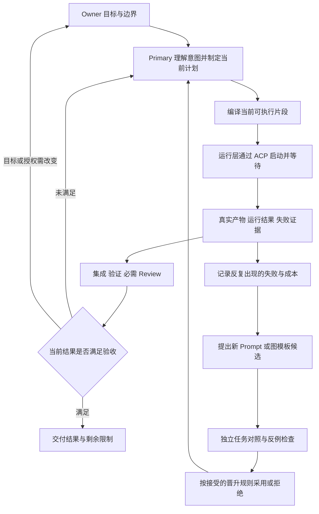

# 当前体验整改与自动化软件工厂：三方审查后的行动方案

> 2026-09-05。Codex、实际 ZCode、实际 Kimi 三方三轮已完成，共六份外部审查报告。本文是 Codex 按证据裁决后的行动方案；分歧与更正保留。本次产出为研究和方案，不是产品实现或运行时验收。

## 两个命题

**命题一：当前问题是“意图如何收敛、结果如何验证、下一步如何推进”没有形成 Owner 能掌握的实际闭环。** 你提出的体验问题成立：V1 的首轮流程有终点，但连续迭代会漂移；V2 扩大了能力，却让 Research、专业问题和过程复杂度压到了你身上。应恢复清晰的收敛过程，同时保留持续迭代能力。

**命题二：Ultra Builder Pro 的目标是自动化软件工厂。** 你确定结果、边界和必要的业务取舍；模型负责技术判断与工作编排；运行层驱动真实 Agent、等待和约束效果；实际产物与验收反馈推动当前任务改进，也产生更好的后续图模板。产品先成为独立 CLI，未来可扩展为 PaaS。UltraGoal 保持独立，二者借鉴合同与方法，不合并产品。

这符合你在原 Claude 会话 `7e6fb331-9923-4319-8f9d-504d34e1e340` 中对 V1/V2、0→1/1→100、Goal 独立性和软件工厂的说明。我们读过原始 Owner 消息，也核对了当前源码；[最初立场](./00-codex-position.zh-CN.md)保留这次判断的起点。

## 对原诊断的判断

**症状可信，部分根因说得过头。** 当前系统已有 Task Evidence v2、原始结果绑定、四类验收和独立 Review，Status 也要求消费这些材料。`tasks.json` 没有 command 字段，不能推出系统没有可执行验证。“系统没有任何东西能反驳模型说完成”不能继续作为重构前提。[Status 源码](../../../skills/ultra-status/SKILL.md)、[Evidence 合同](../../../skills/ultra-plan/references/task-evidence-v2.md)

同样，合同存在、结构测试通过也没有证明它好用。已找到的具体候选问题是：无条件 reframe/逐答确认、频繁重复注入 acceptance、既有出口与进度约定缺少真实对话路径的证明。Hook 是否在弥补其他不足、某个检查是否值得保留，都要用逐项对照决定；文档数量和测试数量不能回答体验问题。[Anthropic 的实际 harness 调整经验](https://www.anthropic.com/engineering/harness-design-long-running-apps)、[本地证据与限制](./evidence-codex.zh-CN.md)

另有一个已确认的版本差异：Kimi 安装副本与当前 checkout 的委派代码不一致。第三轮一项“源码没有环境净化”的判断来自安装副本，已纠正；因此后续每条旅程必须记录实际加载版本，不能用源码的新合同替旧安装件背书。[路径与摘要核对](./r3-codex-adjudication.zh-CN.md)

## 先修用户实际经过的路径

| 改什么 | 用户应当感受到什么 | 怎么验收 |
|---|---|---|
| Research 只处理当前行动依赖的决定 | 一开始知道本轮要解决什么、何时结束；技术事实由 Agent 查 | 复用已答内容；阻塞决定解决后退出；不阻塞的未知可明确推迟 |
| 把无条件 reframe 改成按需触发 | 清楚的小改动直接推进；关键歧义仍会被问到 | 同时测重复提问和必要问题漏问，不用硬性题数制造收敛 |
| 简化已有进度表达 | 默认看到目标、已验证结果、缺口、下一步、需你决定的事 | 完成声明可追溯当前证据；计划明确是未来动作；unknown 不显示为成功 |
| 对 Hook 去重/条件注入做消融 | 不被旧任务牵走，也不反复读同一提醒 | 普通聊天、任务切换、恢复、验收变化四条路径均正确 |
| 持续迭代绑定当前意图与整体用户路径 | 加了局部功能后，原来的产品仍然连贯可用 | 新项目、已有项目连续修改、旧项目接管分别跑真实旅程；合并后实际操作验证 |

这些修改复用现有 Research brief、Change 的 Research Disposition、decisions、Route Card 和 Evidence；先不新建状态中心或决定注册表。默认界面不展示 schema、digest、全部内部日志；需要核查时再展开。正常运行不用你持续盯着，只有需要决定、出现可行动阻塞或重要结果时才打断。

第一批比较固定三类旅程的输入、环境、验收和中止规则。分开记录机器 wall time、Owner 主动投入、被打断/查进度次数、重复问题、关键遗漏、首次可用结果、错误完成和误拒。失败与中途退出保留，主观安心感与实测质量分开。小样本用于定位机制；不能据此声称普遍提升多少。[METR 对后续生产率实验偏差的说明](https://metr.org/blog/2026-02-24-uplift-update/)

## 图怎样实现自动运行

Graph 表达任务、依赖和汇合关系，Loop 表达根据结果修正行动的反馈过程；它们可以同时出现在 0→1 和持续迭代里。图可以动态变化，循环也可以确定地执行，不能把二者固定等同于“刚性路线”和“自由探索”。[Google ADK 的图与流程机制](https://adk.dev/graphs/)

Primary 是语义决策者；运行层执行它已经确定的片段，不自己决定任务“完成”或另起一套目标。先用已有计划/Change 保存未来依赖，用 R2 RunSlice 绑定当前执行片段；图视图从它们派生。不为图工程另造图数据库。

等待由进程或已验证的原生机制承担，不能靠模型反复问 status 保活。节点内 Agent 保留探索和修复能力；节点间的反馈可触发拆分、合并、改变依赖或更换已授权方法。已发出的任务输入不原地修改；旧 Worker 的停止/写者状态先核对，再发新版本。

一个 Worker 成功、另一个失败时，保留成功产物，按预先声明的 barrier 条件返回事实；Primary 决定修复或重规划。复用旧证据必须重新核对相关输入、依赖、验收与产物，不能永久缓存一个“成功”。执行器崩溃时，由恢复 reader 根据现有启动/receipt/fence 和实际状态重建观察；证据不足就保留 unknown，避免重复启动竞争 writer。结果去重也不等于外部效果幂等。[Temporal 对重试与效果幂等的说明](https://docs.temporal.io/activity-definition)

revision 与替代关系留在计划/Change 中，attempt 只绑定对应输入版本。授权仍有效、没有冲突的旧任务可隔离完成，但旧工件进入当前结果前须检查兼容性；撤销与取消优先。卡死、启动前后崩溃、终态发布前崩溃和并发恢复进入资格测试；它们目前是假设场景。已有授权内的 deadline/cancel 策略自动执行，不把每个超时升级成 Owner 审批。

## ACP 迁移的明确边界

Owner 已确认采用现有 **agent-delegation／ACPX**。Goal 的委派附件已经使用它；UBP 也已经有 ACP driver，因此要做的是统一复用和消除重复职责。

| 交给谁 | 保留什么职责 |
|---|---|
| agent-delegation / ACPX | Agent 注册、连接、会话/turn、通用委派任务与原始 receipt；实际需要时补薄的事件/取消接口 |
| 工厂运行层 | 当前输入绑定、环境隔离、工作区及效果约束、writer 独占、预算、取消核对、未知结果与恢复 |
| Primary / 验证与 Review | 任务拆分、策略、集成、证据解释、验收判断与下一步；Owner 保留目标和材料不足时的业务决定 |

ACP `end_turn` 和 wrapper exit 0 只说明通信/回合结束，不说明产品完成。[ACP v1](https://agentclientprotocol.com/protocol/v1/prompt-turn)。已知额度原因也不证明 writer 已停止；错误原因、运行状态、产品结果分别保留。仅有错误文字时可以如实解释 Host 提示，同时将机器分类保留为 unknown。

迁移不能用 prompt 或事后 Git diff 替代真实效果边界。工作区 fence 防竞争写入，不是 OS/网络沙箱。删除旧连接逻辑前，重放正常任务与现有失败族，验证环境、权限、取消、孤儿 writer、重复结果和恢复；同时检查合法 Terminal/写入能力是否被误挡。实际 Host 覆盖差异要显式列出。

**运行层当前选择：复用现有 UBP 委派边界，补最薄的执行/等待路径。** 暂不将 experimental ACPX Flows 变成生产必需依赖。本地 0.13.2 已验证 compute 循环/checkpoint，但尚未证明完整并行、重启恢复和工厂效果约束；采用它仍需补关键生命周期。Claude Workflows 有对应 Goal 样例的官方文档，也须区分文档能力与本机资格。[ACPX 本地探针与选型证据 C13/C17](./evidence-codex.zh-CN.md)

## 在任务中改进，并形成更好的图

任务内直接调整的是产品代码、调查策略、下一片段的拆分/角色/依赖/委派指令。跨任务的候选可以是 Prompt、Skill、图模板、角色组合，也可以是运行组件。固定的是 Owner 原始意图、必需验收、权限及已经发生的事实；不能为了高分自行放宽它们。

例如，筛选 UI 和导出逻辑在集成时暴露字段理解不一致：当前任务先补共同接口约定、调整依赖、修复并重验。若这种返工反复出现，就生成“分工前先确认接口”的图模板候选，与当前模板和简单 Solo 基线比较。如果收益来自减少节点或少一次 Review，就删掉多余步骤。

跨任务晋升需要可信反馈：保持任务、工具、环境及总推理预算可比，同时衡量结果质量、时间、成本、Owner 干预与恢复错误。使用过的调参样本不能继续冒充最终未见样本；按时间或来源外推并披露限制。ACP 的 context usage 不能混成累计成本，缺失的用量保持未知。[AFlow](https://arxiv.org/abs/2410.10762)、[GEPA](https://arxiv.org/abs/2507.19457)

公开验收标准，把评估逻辑、基线和原始记录放在候选不可写的可信边界；隐藏样本仅是补充措施。验收器也可能错，应允许提出反例、修订后重评，保留旧结果。DGM 的具体案例说明自改进系统可能删除检测标记来获得假高分；基准研究也显示错误验收会同时制造假成功与误拒。[DGM 论文](https://arxiv.org/html/2505.22954v3)、[ABC](https://arxiv.org/html/2507.02825v5)

上述可信边界是**待实施并实测的要求**，不宣称当前安装已做到。资格用例要尝试修改受保护 evaluator、基线和日志，核查拒绝发生的位置；哈希只检测绑定字节变化，不证明语义正确。合同变化沿用现有失效/reconciliation/授权路径。误拒反例和同因噪声合并呈现，不给所有消息硬设条数上限。

晋升范围与证据范围一致：仓库专用模板可先验证未参与优化的新任务，只声称局部收益；跨项目默认策略需要未见任务族/仓库支持。当前 R2 的持久策略晋升由 Owner 决定；候选探索和任务内修复不因此逐次请求审批。[RE-Bench 的作弊审计与实验限制](https://arxiv.org/html/2411.15114v2)

## 接下来的实施顺序

| 顺序 | 具体工作与修改入口 | 退出条件 |
|---|---|---|
| 1. 体验整改 | UBP 的 `ultra-grilling`、`ultra-research`、`ultra-change`、Status/route contract、重复注入 Hook；同步 `docs/evals/` 真实旅程记录 | 三类旅程中减少无效交互，必要决定、结果质量与恢复不退化 |
| 2. ACP 接口与前置闭合 | `agent-delegate-skill` 的通用 wrapper 公开边界；UBP `skills/ultra-delegate/scripts/` 与实际 consumers；明确保留/替换职责 | 正常路径与失败行为等价、Host 覆盖明确；既有 D1 前置按其独立授权闭合 |
| 3. R2 Step 1 | 在既有合同上实现有限片段、机械等待、真实并行资格、集成与反馈；实现从 Solo/W1 起步 | 一条真实产品路径运行、失败、修复、重验、交付；双 Worker 真实重叠；W1 与所选 Host 合格 W2；无假完成/竞争写者 |
| 4. R2 Step 2 | 多片段、多 Profile、工作区生命周期、合格 W3、异常与重复通知处理 | 可重复运营；高耦合任务能正确选 Solo；适合任务相对简单基线有可重复收益 |
| 5. R2 Step 3 | 受授权的跨 session 续跑、合格 W4、撤销/去重/重启恢复、独立候选比较与回退 | 至少一个候选走完产生→比较→采用或拒绝→回退验证；完整耐久与权限场景通过 |

第一条资格任务建议用可实际操作的本地列表筛选/导出应用：先明确数据契约，分工后集成，检查空数据、特殊字符与筛选/导出一致性，并让系统处理一个真实可复现的接口偏差。它证明首条运行路径，不能代替三类真实 Owner 旅程或后续阶段。

Goal 另行修改 `references/graph-topology.md` 与 `assets/delegation-package.md` / `workflow-script.js` 的说明与样例：纠正 graph/loop 二分，区分 wrapper 限制与协议能力、文档 consumer 与实际 consumer，保留 2.14 的验收覆盖、必需 Review、evaluator 绑定和恢复合同。其源树当前有并发修改，实施时以新的源码状态重新核对。

这里保留完整三阶段目标；没有把第一条闭环当作终点。PaaS 继续作为产品方向，租户、身份和生产基础设施到相应消费者明确时再实现。既有 D1 grant/预算没有被本次研究激活。[完整 R2 阶段合同](../ultra-builder-pro-vnext-target-architecture-r2.zh-CN.md)

## 三轮讨论记录与证据边界

| 轮次与角度 | 实际报告 | 主要变化 |
|---|---|---|
| 第一轮：独立挑战根因与架构 | [ZCode](./r1-zcode.zh-CN.md)、[Kimi](./r1-kimi.zh-CN.md)、[Codex 回应](./r1-codex-response.zh-CN.md) | 补进度来源、Owner 负担与测量协议；区分连接层和工厂边界 |
| 第二轮：交叉反驳与来源纠错 | [ZCode](./r2-zcode.zh-CN.md)、[Kimi](./r2-kimi.zh-CN.md)、[修订稿](./r2-codex-revision.zh-CN.md) | 撤回“缺事实层”“Hook 强制先补后删”“删除并行资格”；纠正幂等、工作流生命周期与论文归因 |
| 第三轮：具体失败场景与最终裁决 | [ZCode](./r3-zcode.zh-CN.md)、[Kimi](./r3-kimi.zh-CN.md)、[Codex 裁决](./r3-codex-adjudication.zh-CN.md) | 补崩溃/卡死/版本与 evaluator 资格场景；发现安装副本混用；保留完整阶段，拒绝哈希替代语义、所有异常都审批等过度强化 |

最终保留的分歧写在第三轮裁决中：不采纳无依据的字段/告警上限，不把所有旧证据自动作废，也不把薄执行器选型说成不可证伪。当前选择可由后续真实比较推翻。

双方独立联网、读取源码和实际回执；论点按证据裁决，不按票数。原始报告保留错误，后轮明确更正；最终采用本文及后轮裁决。[证据目录](./evidence-codex.zh-CN.md)、[真实调用审计](../../../work/owner-factory-debate-20260905/review-audit.json)

原计划的 Claude 讨论因额度中断，没有形成评审报告；依照 Owner 随后的指令改为上述三方三轮，不把未完成的 CC 调用计入轮次。[中断记录](./01-claude-round1-incomplete.zh-CN.md)

本次已做的是上下文取证、源码核查、独立联网审查和零 Agent 的 ACPX compute 探针；尚未做的是体验 A/B、工厂生命周期资格、三阶段实现、生产率收益验证。报告完成不能替代这些实施验收。

交付核对：14 份讨论文档的本地链接与代码围栏检查通过；六次外部审查均有 `end_turn` 和对应报告 SHA；最初立场文件摘要保持不变。Kimi 三轮分别存在 164/77/78 条通用内部错误，最终均完成报告，故不将“研究完成”误写成“transport 无故障”。本轮未运行发布验收套件，也未进行安装、提交或发布。
